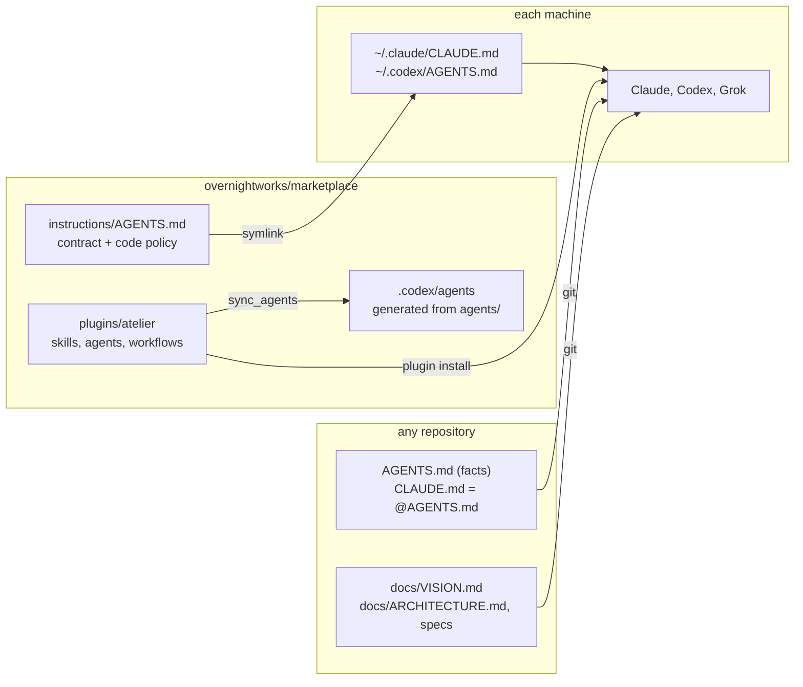

# Architecture

Reader: a human operator or engineer asking where agent guidance lives and why
it is never copied. Type: architecture overview. Commands live in the
[README](../README.md), rules in the [contract](../instructions/AGENTS.md), and
the list of documents a repository carries in the
[write-docs skill](../plugins/atelier/skills/write-docs/SKILL.md).

## Mental model

Guidance has three owners, and each reaches an agent by its own route:

- **The contract and code policy** are one file, written once, installed per
  machine.
- **The plugin** carries skills, agents and workflows to every host that
  installs it.
- **A repository** carries only its own facts, through git.

Question answered: where does each kind of agent guidance live and how does it
arrive. Sources: `instructions/`, `plugins/atelier/`, the README install and
agent sections.

## Why there are no copies

A rule copied into a repository is owned by nobody: the copies drifted by dozens
of lines and contradicted current rules, and repositories that were never
seeded had no code policy at all. One file installed on the machine reaches
every repository at once and cannot diverge. The price is that the checkout
must be an up-to-date `main`, because agents read whatever it holds.
