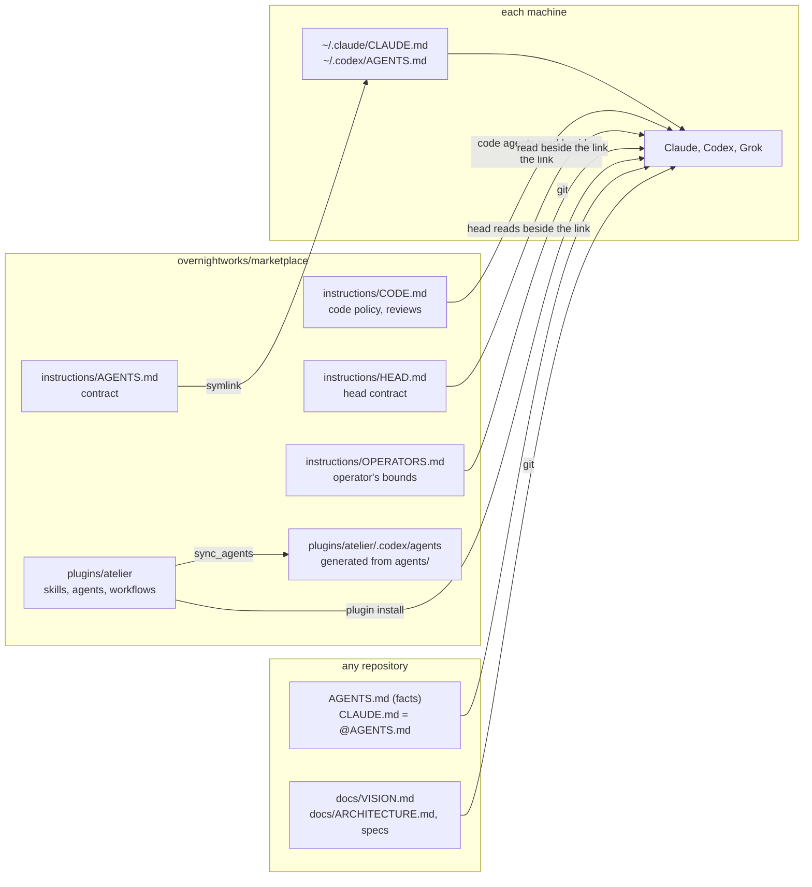
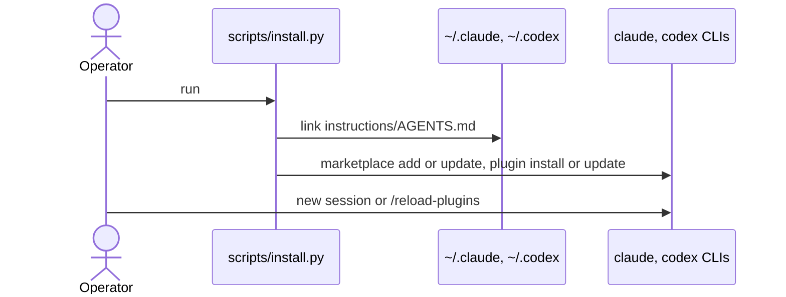

# Architecture

Reader: a human operator or engineer asking where agent guidance lives and why
it is never copied. Install and verification commands live in the
[README](../README.md), rules in the [contract](../instructions/AGENTS.md),
its [code policy](../instructions/CODE.md), its
[head part](../instructions/HEAD.md) and the operator's
[bounds](../instructions/OPERATORS.md), and
the list of documents a repository carries in the
[write-docs skill](../plugins/atelier/skills/write-docs/references/document-types.md#repository-document-set).
The [fleet standards](standards.md) index names each standard that covers
several of the operator's repositories and links to its owner.

## 1. Context and Scope

Guidance has three owners, and each reaches an agent by its own route: the
contract and code policy by a per-machine link, the plugin by plugin install,
and a repository's own facts through git. This repository owns the first two,
and the Claude Code settings every session shares (section 5).
Outside it stand the hosts that read the guidance (Claude Code, Codex, Grok),
the operator's machine, and every repository the operator's agents work in.

## 2. Building Block View

- `instructions/` holds the contract (`AGENTS.md`, for every agent), the code
  policy and Reviews (`CODE.md`, for the agents that code, test, write
  documentation or judge a finding), the head contract (`HEAD.md`, for the head
  alone) and the operator's bounds (`OPERATORS.md`).
- `plugins/atelier/` is the plugin: skills shared by both hosts, the Markdown
  source of every agent, and the Claude Code workflows. The Codex agent files
  are generated from that source.
- `scripts/install.py` is the one installer: it links the contract and has one
  branch per host (link, marketplace and plugin commands). The Codex agents
  come from `scripts/sync_agents.py`; the other scripts check the sources. The
  [README](../README.md) owns the layout and commands.

## 3. Runtime View

The core flow is an install: one command puts the contract and the plugin in
front of every host on the machine.

Grok reads `~/.claude/CLAUDE.md` through its Claude compatibility
(`compat.claude.agents`, on by default).

No provider loads `instructions/HEAD.md` by itself. `AGENTS.md` tells the head
to read it before its first answer, and again after a compaction or a resume,
with one command that resolves the link and prints "HEAD.md not read" when it
fails. A helper is told apart by its first message, another agent's brief that
opens with the delegated line; it reads only a section of `HEAD.md` its brief
names.

A Claude Code head that is running when the contract changes learns of it
through the plugin's hook, `plugins/atelier/hooks/contract_change.py`. The host
runs it at session start, at each prompt and after each tool batch. It compares
the committed `AGENTS.md`, `CODE.md`, `HEAD.md` and `OPERATORS.md` of the checkout
the contract link points into with the blobs the session last saw, and injects the changed lines with
the subjects of the commits that changed them, once per change. A subagent, a
workflow agent and a session whose first prompt opens with the delegated line
(read from the contract's "Head or helper" blockquote) get nothing. Per-session
state, only commit and blob ids and the role, lives in the plugin's data
directory.

A second hook, `plugins/atelier/hooks/fleet_plans.py`, runs at each prompt. When
a head's prompt names a repository action (rename, publish, archive, migrate,
move, a new repository), it reads `aco fleet-plans --json` and injects at most
five of the open fleet-wide plans, as data under a fixed heading, once per
plan set; a failed read is said in one line, once per reason. It reuses the
contract hook's decision of who is a head, so a helper gets nothing. Its state,
plan and failure identifiers and the role, lives beside the contract hook's.

A third hook, `plugins/atelier/hooks/oom_first.py`, runs at session start and
writes 1000 to the `oom_score_adj` of the session's process, which the
processes it starts inherit, so at an out-of-memory kill agent work ranks level
with the platform's BestEffort pods instead of behind them. The process is the
pid in the hook's own `CLAUDE_PID`, accepted only when it is an ancestor of the
hook. A failure is said in a `systemMessage` and never blocks the session.

Only Claude Code runs the hooks; their file, `hooks/claude-hooks.json`, is named
in `.claude-plugin/plugin.json` alone, so Codex does not discover it. A head
running on Codex or Grok is therefore not told of a contract change; it
reads the contract again only at its session start, a compaction or a resume.

## 4. Deployment View

Nothing runs as a service. The checkout on the operator's machine is the
source: the contract is read through links into it, and the plugin is copied
into each host by the host's own plugin command, from this checkout or from the
published GitHub copy. CI runs on GitHub Actions.

## 5. Crosscutting Concepts

**Trust.** The operator and his agents write the contract and the plugin; a
change to a contract rule lands only with the operator's ruling, and the
[README](../README.md) names the check that protects `main`. The installer is
trusted with the operator's home directory: it creates only the two contract
links and the `probe-run` link in `~/.local/bin`, and their parent directories,
where they are missing; it refuses before touching anything when any of the
three paths holds something else; it writes the managed-settings copy and,
once the drop-in links it, removes the shipped keys from `~/.claude/settings.json`; and it runs the
`claude` and `codex` CLIs with fixed arguments, nothing built from external
input. The plugin hosts (Claude Code, Codex) and Grok, which reads the contract
through its Claude compatibility, are trusted to load what they read. The
installer adds the published GitHub copy by default (the operator's own remote),
which is trusted likewise. Skills, agents and workflows run with the permissions
the operator gives the host, and this repository adds no sandbox around them.
Dependencies are pinned: CI actions and the shared quality workflows by commit
SHA, `uv` and Python by version, test dependencies in `uv.lock`; Dependabot
proposes monthly bumps that are reviewed like any change. No narrower trust
model than the audit skill's default is declared.

**Shipped Claude Code settings.** `settings/claude-managed.json` is the only
owner of the keys it holds, and `scripts/install.py` is the only owner of which
keys that may be. Claude Code reads the managed layer above the user file and
no `/config` write reaches it, so a shipped value is changed here, never
locally. The installer validates the file and writes a copy under
`~/.local/share/marketplace/`; the operator links the copy as a drop-in once,
because `/etc` needs root and the installer never runs `sudo`. A branch switch
or half-finished edit in the checkout therefore never reaches a session. The
managed layer only delivers settings and is no security boundary: its target is
a file the operator owns. The file holds no private repository name or secret
location; those stay in the user file with whatever `/config` writes. Plugin
registration (`enabledPlugins`, `extraKnownMarketplaces`) stays with the
installer's `claude plugin` calls.

**Proof strategy.** CI on every pull request checks that the generated Codex
agents match their source, that no symlink is tracked, that every contract file is
within its byte budget, that every skill is valid, that every
workflow's metadata parses, that the shipped Claude Code settings pass the
published settings schema, and runs the workflow tests, and the script and hook tests
with branch-coverage floors (100 % for the scripts, 95.5 % for the lane bundle,
held by `scripts/check_branch_floor.mjs`); the shared quality gate then judges the whole.
Documentation is proven by review.

## 6. Constraints and reasons

- **No copies of the contract.** A rule copied into a repository is owned by
  nobody: the copies drifted by dozens of lines and contradicted current rules,
  and repositories that were never seeded had no code policy at all. One file
  installed on the machine reaches every repository at once and cannot diverge.
- **Generated agents are never edited.** The Markdown source is the only
  owner; the Codex files follow it, and CI fails when they differ.
- **One file per audience.** `HEAD.md` stays apart from `AGENTS.md` so helpers
  do not carry the head's coordination rules, and `CODE.md` holds what only
  coding agents and judges of a finding read, so a research helper or a landing
  courier does not carry it. Each file has a byte budget in CI, below Codex's
  instruction-file limit, because loaded tokens follow bytes.

## 7. Not chosen

- Copying the contract into each repository: see section 6. Reopen if a
  host stops reading user-level instructions.
- A read line for `CODE.md` in each code agent's file: it would be a second
  loader before the loads list exists. Reopen when roles get loads lists.
- Loading `HEAD.md` through a provider: none loads it by itself. Reopen when a
  host offers a channel for one agent role only.
- A top role that draws its work from weighted moods and tunes the weights by
  its own outcome record. In the agents' reading such a record drifts from the
  operator's wishes toward tidying. Pointers: overnightworks/foreman
  `89c3f5041`, `8218a4d60`. Reopen if the operator's reactions, not its record,
  set the weights.
- A durable graph engine that runs the company's workflows. In the agents'
  reading it is never easier to run than a head with helpers. The operator on
  atelier-2's attempt at role context and process optimisation
  (overnightworks/aco#1080, comment 7200901315):

  > „sind im security theater gelandet vermute ich?“

  Pointer: overnightworks/atelier-2#1523. Reopen when a flow beside the lane
  workflow needs branching or resuming that a script cannot express.
- A runner that reads a session's state from its screen and types into an idle
  seat. In the agents' reading a screen is no liveness signal: its reading
  breaks whenever the screen changes. Pointers: overnightworks/atelier
  `bea9d6a5e`, `67ffa66fd`, `e0b563f56`. Reopen if a provider offers no
  liveness signal but its screen.
- Starting headless sessions without a probe per login first. In the agents'
  reading concurrent starts in one login directory die without an error.
  Pointers: overnightworks/atelier-2#993, #942. Reopen if a provider documents
  concurrent starts per login directory as supported.
- Promoting a role by a measured success threshold. In the agents' reading a
  threshold's sample outlasts the change it judges, so measurement may warn or
  take back, and the operator's reaction judges. Pointer:
  overnightworks/atelier-2#106. Reopen if a trial (a rule change landed on
  probation, `instructions/HEAD.md`, Rule changes) reaches the measure it named
  before it began within a few weeks.

## 8. Risks and Technical Debt

- Agents read whatever the checkout holds, so it must be an up-to-date `main`;
  a stale or half-merged checkout silently changes every agent's rules.
- `CODE.md` reaches a coding agent only if it follows the pointer in
  `AGENTS.md`, and no check sees one that skipped it.
- A long read can reach the model only in part: Claude Code stored a 19.8 KB
  command output in a file and showed a 2 KB preview. The pointer says to read
  `CODE.md` whole; whether Codex sees a 17 KB read whole is unverified.
- Grok depends on another provider's compatibility setting to see the
  contract.
- After an install, a running session keeps the plugin version it loaded,
  the hooks included; the out-of-memory rank reaches it at its next restart.
- The out-of-memory rank is cooperative: an agent can lower its own score
  again, and Docker containers take their score from their container spec.
  Codex and Grok heads are not reached.
- The lane's Codex courier takes its brief from its own transcript under
  `~/.claude/projects/*/*/subagents/workflows/*/agent-*.jsonl`, which a
  workflow script cannot write itself. A host that moves that layout shows as
  the lane returning to the head with "found no brief in its own transcript",
  never as a wrong brief.
