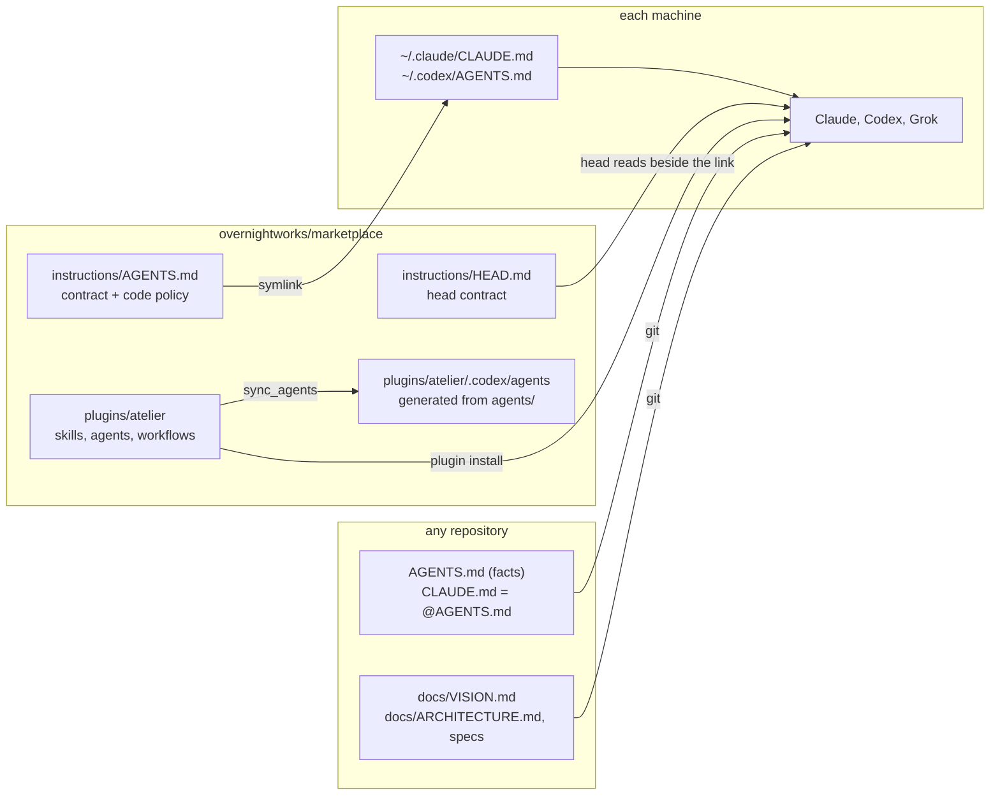
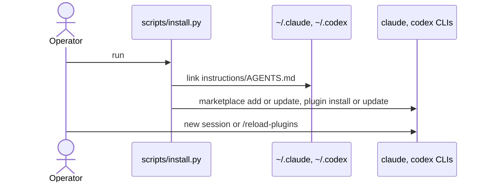

# Architecture

Reader: a human operator or engineer asking where agent guidance lives and why
it is never copied. Install and verification commands live in the
[README](../README.md), rules in the [contract](../instructions/AGENTS.md) and
its [head part](../instructions/HEAD.md), and
the list of documents a repository carries in the
[write-docs skill](../plugins/atelier/skills/write-docs/references/document-types.md#repository-document-set).
The [fleet standards](standards.md) index names each standard that covers
several of the operator's repositories and links to its owner.

## 1. Context and Scope

Guidance has three owners, and each reaches an agent by its own route: the
contract and code policy by a per-machine link, the plugin by plugin install,
and a repository's own facts through git. This repository owns the first two.
Outside it stand the hosts that read the guidance (Claude Code, Codex, Grok),
the operator's machine, and every repository the operator's agents work in.

## 2. Building Block View

- `instructions/` holds the contract and code policy (`AGENTS.md`, for every
  agent) and the head contract (`HEAD.md`, for the head alone).
- `plugins/atelier/` is the plugin: skills shared by both hosts, the Markdown
  source of every agent, and the Claude Code workflows. The Codex agent files
  are generated from that source.
- `scripts/install.py` is the one installer: it links the contract and has one
  branch per host (link, marketplace and plugin commands). The Codex agents
  come from `scripts/sync_agents.py`; the other scripts check the sources. The
  [README](../README.md) owns the layout and commands.

## 3. Runtime View

The core flow is an install: one command puts the contract and the plugin in
front of every host on the machine.

Grok reads `~/.claude/CLAUDE.md` through its Claude compatibility
(`compat.claude.agents`, on by default).

No provider loads `instructions/HEAD.md` by itself. `AGENTS.md` tells the head
to read it before its first answer, and again after a compaction or a resume,
with one command that resolves the link and prints "HEAD.md not read" when it
fails. A helper is told apart by its first message, another agent's brief that
opens with the delegated line; it reads only a section of `HEAD.md` its brief
names.

A Claude Code head that is running when the contract changes learns of it
through the plugin's hook, `plugins/atelier/hooks/contract_change.py`. The host
runs it at session start, at each prompt and after each tool batch. It compares
the committed `AGENTS.md` and `HEAD.md` of the checkout the contract link points
into with the blobs the session last saw, and injects the changed lines with
the subjects of the commits that changed them, once per change. A subagent, a
workflow agent and a session whose first prompt opens with the delegated line
(read from the contract's "Head or helper" blockquote) get nothing. Per-session
state, only commit and blob ids and the role, lives in the plugin's data
directory.

A second hook, `plugins/atelier/hooks/fleet_plans.py`, runs at each prompt. When
a head's prompt names a repository action (rename, publish, archive, migrate,
move, a new repository), it reads `aco fleet-plans --json` and injects at most
five of the open fleet-wide plans, as data under a fixed heading, once per
plan set; a failed read is said in one line, once per reason. It reuses the
contract hook's decision of who is a head, so a helper gets nothing. Its state,
plan and failure identifiers and the role, lives beside the contract hook's.

Only Claude Code runs the hooks; their file, `hooks/claude-hooks.json`, is named
in `.claude-plugin/plugin.json` alone, so Codex does not discover it.

## 4. Deployment View

Nothing runs as a service. The checkout on the operator's machine is the
source: the contract is read through links into it, and the plugin is copied
into each host by the host's own plugin command, from this checkout or from the
published GitHub copy. CI runs on GitHub Actions.

## 5. Crosscutting Concepts

**Trust.** The operator and his agents write the contract and the plugin; a
change to a contract rule lands only with the operator's ruling, and the
[README](../README.md) names the check that protects `main`. The installer is
trusted with the operator's home directory: it creates only the two contract
links, and their parent directories, where they are missing; it refuses before
touching anything when either path holds something else; and it runs the
`claude` and `codex` CLIs with fixed arguments, nothing built from external
input. The plugin hosts (Claude Code, Codex) and Grok, which reads the contract
through its Claude compatibility, are trusted to load what they read. The
installer adds the published GitHub copy by default (the operator's own remote),
which is trusted likewise. Skills, agents and workflows run with the permissions
the operator gives the host, and this repository adds no sandbox around them.
Dependencies are pinned: CI actions and the shared quality workflows by commit
SHA, `uv` and Python by version, test dependencies in `uv.lock`; Dependabot
proposes monthly bumps that are reviewed like any change. No narrower trust
model than the audit skill's default is declared.

**Proof strategy.** CI on every pull request checks that the generated Codex
agents match their source, that no symlink is tracked, that the contract fits
Codex's instruction-file size limit, that every skill is valid and every
workflow's metadata parses, and runs the workflow tests, and the script and hook tests
at 100 % branch coverage; the shared quality gate then judges the whole.
Documentation is proven by review.

## 6. Constraints and reasons

- **No copies of the contract.** A rule copied into a repository is owned by
  nobody: the copies drifted by dozens of lines and contradicted current rules,
  and repositories that were never seeded had no code policy at all. One file
  installed on the machine reaches every repository at once and cannot diverge.
- **Generated agents are never edited.** The Markdown source is the only
  owner; the Codex files follow it, and CI fails when they differ.
- **One file per audience.** `HEAD.md` stays apart from `AGENTS.md` so helpers
  do not carry the head's coordination rules; the contract stays under the
  Codex size limit.

## 7. Not chosen

- Copying the contract into each repository: see section 6. Reopen if a
  host stops reading user-level instructions.
- Loading `HEAD.md` through a provider: none loads it by itself. Reopen when a
  host offers a channel for one agent role only.

## 8. Risks and Technical Debt

- Agents read whatever the checkout holds, so it must be an up-to-date `main`;
  a stale or half-merged checkout silently changes every agent's rules.
- Grok depends on another provider's compatibility setting to see the
  contract.
- After an install, a running session keeps the plugin version it loaded,
  the hooks included.
