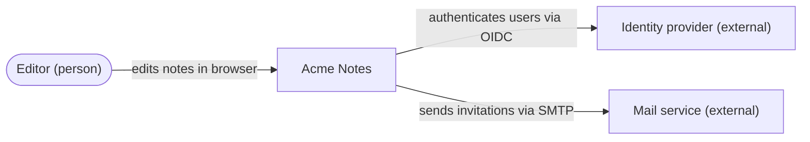
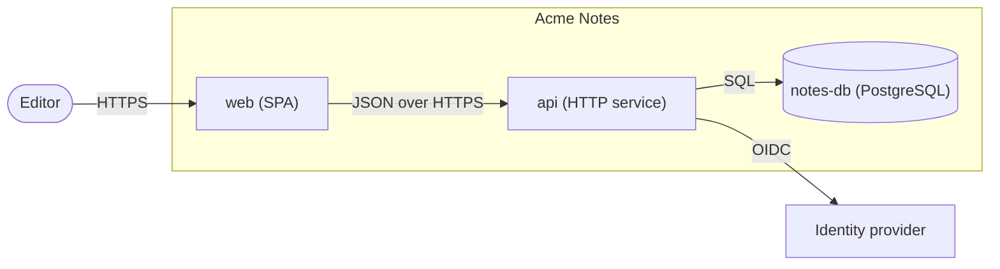
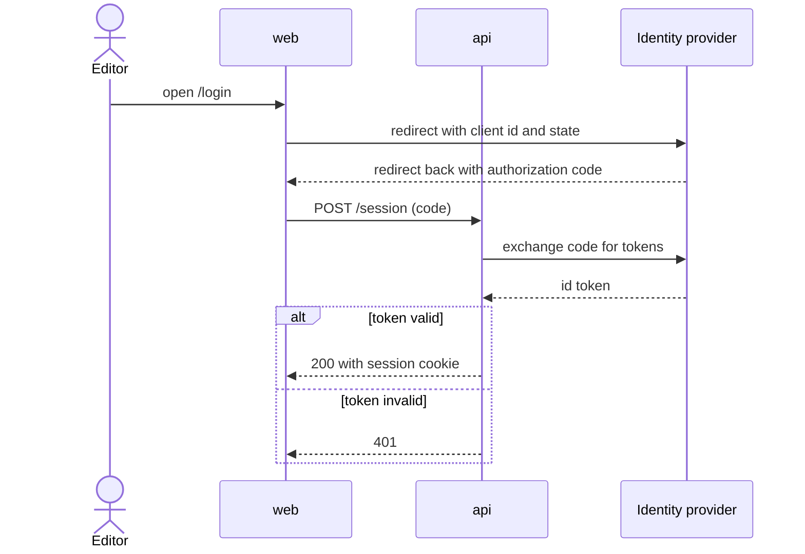

# Worked diagram examples

Mermaid, fictional "Acme Notes". Each diagram carries its question and source
caption and every edge is a checked claim (a real call, import or message in
the named source). The altitudes follow the C4 model, <https://c4model.com/>:
context, container, component, code. Pick the level by the audience's
question; the examples show the first two.

## C4 level 1: context

Question: who and what interacts with Acme Notes? Audience: outsiders and
operators. Source: the deployment config and the integration clients.

## C4 level 2: container

Question: which deployable parts make up Acme Notes, and what talks to what?
Audience: operators and engineers. Source: one container per entry in the
compose file; one edge per client call in the code.

## Sequence: login flow

Question: in which order do the parties act when an editor logs in? Audience:
engineers changing authentication. Source: the login route handler and the
OIDC client.

